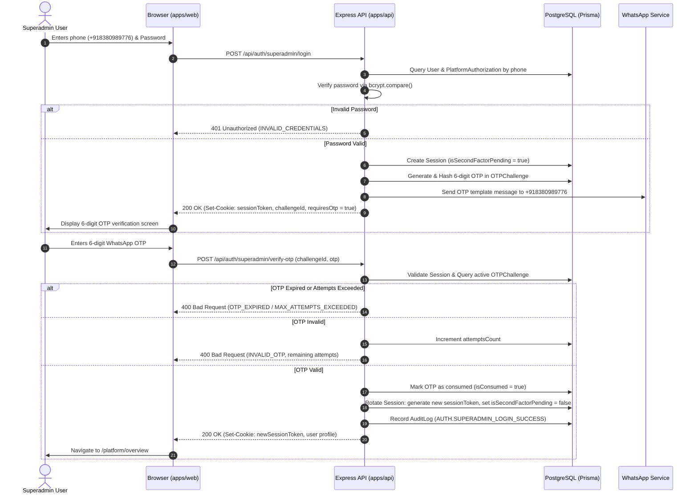
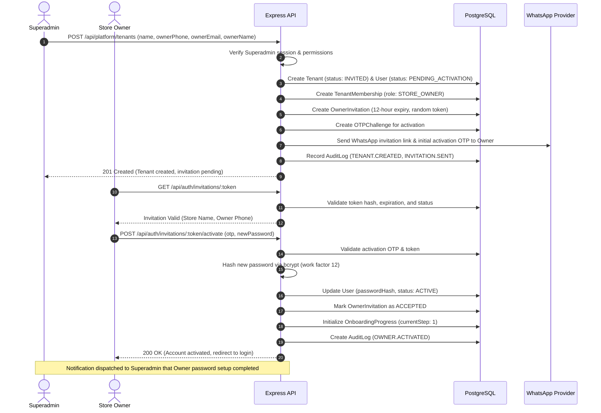
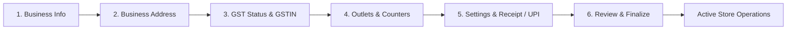

# Architecture Document: 08 — Authentication, Authorization & Multi-Tenant Access Foundation

- **Module:** Security & Access Control
- **Work Package:** WP-02 — Authentication & Access Foundation
- **Microtask:** BB-WP02-00.01 — Architecture & Requirements Baseline
- **Date:** 2026-11-07
- **Status:** Architecture Blueprint (Awaiting Human Review)

---

## 1. Architectural Philosophy & Core Tenets

The BillingBuddy authentication system governs both **Platform Superadmin operations** (infrastructure, licensing, tenant lifecycle) and **Store Owner operations** (retail billing, point of sale, inventory, and ledger).

### Foundational Principles:
1. **Zero Browser Trust:** Tenant context, user identities, and role capabilities are determined strictly server-side via authenticated session context. Client requests cannot specify or override `tenantId` or role claims.
2. **Strict Identity vs. Membership Separation:** A `User` is an authenticatable human identity. A `TenantMembership` binds that user to a specific `Tenant` with a designated `Role`. Superadmins hold platform-level capabilities that do not require tenant membership.
3. **Mandatory Two-Factor Gating for Superadmins:** Root platform administration mandates two factors: password verification followed by a one-time WhatsApp OTP. The dashboard session is unlocked only after valid OTP verification.
4. **Opaque Server-Side Sessions:** To eliminate XSS token theft and enable instant token revocation across active devices, authentication uses opaque server-stored sessions delivered over `httpOnly`, `Secure`, `SameSite=Lax` cookies. `localStorage` is strictly prohibited for auth tokens.
5. **Fail-Closed Isolation:** All tenant resource queries must explicitly inject `tenantId` derived from the verified session context.

---

## 2. Entity Relationship Model & Prisma Schema Proposal

```mermaid
erDiagram
    User ||--o{ PlatformAuthorization : has
    User ||--o{ TenantMembership : belongs_to
    Tenant ||--o{ TenantMembership : employs
    Tenant ||--o{ OwnerInvitation : issues
    User ||--o{ Session : establishes
    User ||--o{ OTPChallenge : receives
    Tenant ||--o| OnboardingProgress : tracks
    User ||--o{ AuditLog : generates
    Tenant ||--o{ AuditLog : records

    User {
        uuid id PK
        string email UK
        string phone UK
        string passwordHash
        string fullName
        string status
        datetime createdAt
        datetime updatedAt
    }

    PlatformAuthorization {
        uuid id PK
        uuid userId FK,UK
        string role "SUPERADMIN"
        datetime grantedAt
    }

    Tenant {
        uuid id PK
        string slug UK
        string name
        string status "INVITED, ACTIVE, SUSPENDED"
        datetime createdAt
        datetime updatedAt
    }

    TenantMembership {
        uuid id PK
        uuid tenantId FK
        uuid userId FK
        string role "STORE_OWNER, STORE_CASHIER"
        string status "ACTIVE, INACTIVE"
        datetime joinedAt
    }

    Session {
        uuid id PK
        string sessionTokenHash UK
        uuid userId FK
        uuid activeTenantId FK
        string sessionType "PLATFORM, TENANT"
        boolean isSecondFactorPending
        datetime expiresAt
        datetime lastSeenAt
        string ipAddress
        string userAgent
    }

    OTPChallenge {
        uuid id PK
        uuid userId FK
        string phone
        string otpHash
        string purpose "SUPERADMIN_LOGIN, OWNER_ACTIVATION"
        integer attemptsCount
        integer maxAttempts
        datetime expiresAt
        boolean isConsumed
        datetime createdAt
    }

    OwnerInvitation {
        uuid id PK
        uuid tenantId FK
        string invitedEmail
        string invitedPhone
        string tokenHash UK
        uuid otpChallengeId FK
        string status "PENDING, ACCEPTED, EXPIRED, REVOKED"
        datetime expiresAt
        datetime createdAt
    }

    OnboardingProgress {
        uuid id PK
        uuid tenantId FK,UK
        integer currentStep
        boolean isCompleted
        json stepData
        datetime completedAt
        datetime updatedAt
    }

    AuditLog {
        uuid id PK
        uuid actorUserId FK
        uuid targetTenantId FK
        string action
        string entityType
        string entityId
        json metadata
        string ipAddress
        string userAgent
        datetime createdAt
    }
```



### Proposed Prisma Schema Extension (Target for WP-02 Implementation)

```prisma
// User entity representing unique human identities
model User {
  id                    String                 @id @default(uuid())
  email                 String                 @unique
  phone                 String                 @unique // E.164 formatted (+91...)
  passwordHash          String?                // Nullable for invited owners until activation
  fullName              String
  status                String                 @default("ACTIVE") // ACTIVE, SUSPENDED, PENDING_ACTIVATION
  emailVerified         Boolean                @default(false)
  phoneVerified         Boolean                @default(false)
  createdAt             DateTime               @default(now())
  updatedAt             DateTime               @updatedAt

  platformAuthorization PlatformAuthorization?
  tenantMemberships     TenantMembership[]
  sessions              Session[]
  otpChallenges         OTPChallenge[]
  auditLogs             AuditLog[]

  @@index([phone])
  @@index([email])
}

// Platform-level authorization for root superadmins
model PlatformAuthorization {
  id        String   @id @default(uuid())
  userId    String   @unique
  user      User     @relation(fields: [userId], references: [id], onDelete: Cascade)
  role      String   @default("SUPERADMIN")
  grantedAt DateTime @default(now())
}

// Tenant organization (store or business entity)
model Tenant {
  id                 String              @id @default(uuid())
  slug               String              @unique
  name               String
  status             String              @default("INVITED") // INVITED, ACTIVE, SUSPENDED
  createdAt          DateTime            @default(now())
  updatedAt          DateTime            @updatedAt

  memberships        TenantMembership[]
  invitations        OwnerInvitation[]
  onboardingProgress OnboardingProgress?
  auditLogs          AuditLog[]
  sessions           Session[]
}

// Association between User and Tenant with tenant-specific roles
model TenantMembership {
  id        String   @id @default(uuid())
  tenantId  String
  tenant    Tenant   @relation(fields: [tenantId], references: [id], onDelete: Cascade)
  userId    String
  user      User     @relation(fields: [userId], references: [id], onDelete: Cascade)
  role      String   // STORE_OWNER, STORE_CASHIER
  status    String   @default("ACTIVE") // ACTIVE, INACTIVE
  joinedAt  DateTime @default(now())

  @@unique([tenantId, userId])
  @@index([userId])
  @@index([tenantId])
}

// Opaque server-side sessions
model Session {
  id                    String    @id @default(uuid())
  sessionTokenHash      String    @unique
  userId                String
  user                  User      @relation(fields: [userId], references: [id], onDelete: Cascade)
  activeTenantId        String?
  activeTenant          Tenant?   @relation(fields: [activeTenantId], references: [id], onDelete: Cascade)
  sessionType           String    // PLATFORM, TENANT
  isSecondFactorPending Boolean   @default(false)
  expiresAt             DateTime
  lastSeenAt            DateTime  @default(now())
  ipAddress             String?
  userAgent             String?
  createdAt             DateTime  @default(now())

  @@index([userId])
  @@index([sessionTokenHash])
  @@index([expiresAt])
}

// One-Time Password Challenges for 2FA and activations
model OTPChallenge {
  id             String            @id @default(uuid())
  userId         String?
  user           User?             @relation(fields: [userId], references: [id], onDelete: Cascade)
  phone          String
  otpHash        String
  purpose        String            // SUPERADMIN_LOGIN, OWNER_ACTIVATION
  attemptsCount  Int               @default(0)
  maxAttempts    Int               @default(3)
  expiresAt      DateTime
  isConsumed     Boolean           @default(false)
  createdAt      DateTime          @default(now())

  invitations    OwnerInvitation[]

  @@index([phone, purpose])
  @@index([expiresAt])
}

// Store Owner invitations created by Superadmin
model OwnerInvitation {
  id             String       @id @default(uuid())
  tenantId       String
  tenant         Tenant       @relation(fields: [tenantId], references: [id], onDelete: Cascade)
  invitedEmail   String
  invitedPhone   String
  tokenHash      String       @unique
  otpChallengeId String?
  otpChallenge   OTPChallenge? @relation(fields: [otpChallengeId], references: [id], onDelete: SetNull)
  status         String       @default("PENDING") // PENDING, ACCEPTED, EXPIRED, REVOKED
  expiresAt      DateTime
  createdAt      DateTime     @default(now())
  acceptedAt     DateTime?

  @@index([tokenHash])
  @@index([tenantId])
}

// Mandatory 6-step store onboarding state tracking
model OnboardingProgress {
  id          String    @id @default(uuid())
  tenantId    String    @unique
  tenant      Tenant    @relation(fields: [tenantId], references: [id], onDelete: Cascade)
  currentStep Int       @default(1)
  isCompleted Boolean   @default(false)
  stepData    Json      @default("{}")
  completedAt DateTime?
  updatedAt   DateTime  @updatedAt
}

// Security, authentication, and governance audit trail
model AuditLog {
  id             String    @id @default(uuid())
  actorUserId    String?
  actorUser      User?     @relation(fields: [actorUserId], references: [id], onDelete: SetNull)
  targetTenantId String?
  targetTenant   Tenant?   @relation(fields: [targetTenantId], references: [id], onDelete: SetNull)
  action         String    // AUTH.LOGIN_SUCCESS, TENANT.INVITATION_SENT, etc.
  entityType     String
  entityId       String?
  metadata       Json?
  ipAddress      String?
  userAgent      String?
  createdAt      DateTime  @default(now())

  @@index([actorUserId])
  @@index([targetTenantId])
  @@index([action])
  @@index([createdAt])
}
```

---

## 3. Authentication State Machines & Workflows

### A. Superadmin Authentication Workflow


### B. Tenant Creation & Owner Invitation Workflow


---

## 4. OTP and WhatsApp Security Specification

### A. Cryptographic OTP Generation
- **Generator:** `crypto.randomInt(100000, 1000000).toString()` yielding uniform distribution across $[100000, 999999]$.
- **Storage at Rest:** OTPs are never stored in plain text. Stored as `HMAC-SHA256(otp, PEPPER)` or salted hash in `OTPChallenge.otpHash`.
- **Zero Logging Policy:** Structured request loggers explicitly redact keys matching `/otp/i`, `/token/i`, `/password/i`, `/cookie/i`.

### B. Security Thresholds & Policies
| Parameter | Proposed Value | Security Justification |
|---|---|---|
| **OTP Validity Window** | 5 minutes (300 seconds) | Limits brute-force exposure window |
| **Maximum Verification Attempts**| 3 attempts per challenge | Prevents guessing ($10^{-6}$ entropy) |
| **Resend Cooldown** | 60 seconds per phone number | Thwarts SMS/WhatsApp flooding & API abuse |
| **Max Resends per Hour** | 5 resends per phone / IP | Protects telecom budget and prevents harassment |
| **Invitation Validity Window**| 12 hours | Strict compliance with business requirements |

### C. WhatsApp Provider Abstraction
To prevent tight coupling and support staging mocks vs. production providers (e.g., Gupshup, Twilio, Meta Cloud API):
```javascript
// Provider contract interface
export class WhatsAppProvider {
  async sendOtpMessage({ phone, otp, expiryMinutes }) {
    throw new Error('sendOtpMessage must be implemented by provider');
  }

  async sendInvitationMessage({ phone, invitationLink, tenantName, expiryHours }) {
    throw new Error('sendInvitationMessage must be implemented by provider');
  }
}
```

---

## 5. Password & Session Security Specification

### A. Password Security
- **Hashing Engine:** Native `bcrypt` (C++ native binding, compiled via `node-gyp`). Prohibits `bcryptjs`.
- **Cost Factor:** 12 rounds (~250–350ms hash calculation in Node.js, providing robust resistance against GPU cracking while maintaining responsive HTTP throughput).
- **Password Policy:** Minimum 10 characters, at least 1 uppercase letter, 1 lowercase letter, 1 digit, and 1 special symbol (`!@#$%^&*()_+-=[]{}|;:,.<>?`).

### B. Session Architecture: Opaque Server-Side vs. Stateless JWT

| Architectural Factor | Stateless JWT | Opaque Server-Side Session (Recommended) |
|---|---|---|
| **Instant Revocation** | Difficult (requires global Redis blocklists) | **Instant & Native** (`DELETE / UPDATE Session` in DB) |
| **XSS Vulnerability** | Critical risk if placed in `localStorage` | **Eliminated** via `httpOnly`, `SameSite=Lax` cookies |
| **Privilege Escalation Gate** | Requires token reissue or polling | **Deterministic** (`isSecondFactorPending` flag in DB) |
| **Multi-Tenant Context Switch** | Requires minting new JWTs | **Immediate** update to `activeTenantId` in session record |
| **Token Bloat** | Grows with roles, claims, and tenant IDs | Constant 32-byte cryptographically random token |

**Architectural Decision:** BillingBuddy will use **Opaque Server-Side Sessions** stored in PostgreSQL and delivered via secure `httpOnly` cookies.

### C. Session Cookie Configuration
```javascript
const sessionCookieOptions = {
  httpOnly: true,
  secure: process.env.NODE_ENV === 'production', // true in HTTPS
  sameSite: 'lax',
  path: '/',
  maxAge: 7 * 24 * 60 * 60 * 1000, // 7 days rolling timeout
};
```

### D. Anti-CSRF Mitigation
- Standard `SameSite=Lax` cookie policy protects top-level cross-site GETs.
- State-mutating API requests (`POST`, `PUT`, `PATCH`, `DELETE`) require a custom header: `X-Requested-With: XMLHttpRequest` or an anti-CSRF token verification middleware.

---

## 6. Authorization and Tenant Isolation Design

### A. Server-Side Context Injection
```javascript
// Example middleware flow
export async function requireTenantContext(req, res, next) {
  const session = req.session;
  if (!session || !session.activeTenantId) {
    return res.status(403).json({
      type: 'about:blank',
      title: 'Tenant Context Required',
      status: 403,
      detail: 'No active tenant organization associated with current session.',
    });
  }

  // Inject verified tenant ID into request context
  req.tenantId = session.activeTenantId;
  req.userRole = session.membershipRole;
  next();
}
```

### B. IDOR Defense
Every database query within tenant routes strictly binds to `req.tenantId`:
```javascript
// Safe database isolation pattern
const items = await prisma.inventoryItem.findMany({
  where: {
    tenantId: req.tenantId, // Derived strictly from verified session
    id: req.params.itemId,
  },
});
```

---

## 7. Mandatory Six-Step Onboarding Architecture



1. **Step 1: Business Information** (Trade name, legal entity type, business category, support contact).
2. **Step 2: Business Address** (Store location, building/street, city, state, postal PIN code).
3. **Step 3: GST Registration & Details** (Composition vs. Regular vs. Unregistered; conditional 15-character GSTIN format validation). *Note: Zero hardcoded tax rates or HSN calculations.*
4. **Step 4: Outlets & Counters** (Primary retail outlet name, initial billing counter identifier e.g. "Counter 01").
5. **Step 5: Store Settings & Preferences** (Thermal receipt header/footer lines, UPI VPA payment handle, thermal printer width 58mm/80mm).
6. **Step 6: Review & Final Confirmation** (Comprehensive summary of steps 1–5, declaration, activation commit).

---

## 8. API Contract Catalogue

### Public & Authentication Endpoints
- `POST /api/auth/superadmin/login` — Phone/email + password verification.
- `POST /api/auth/superadmin/verify-otp` — Verifies WhatsApp OTP and unlocks platform session.
- `GET /api/auth/session` — Resolves authenticated user profile, active tenant, and capabilities.
- `POST /api/auth/logout` — Destroys server-side session and clears cookie.
- `GET /api/auth/invitations/:token` — Validates invitation token for Store Owner.
- `POST /api/auth/invitations/:token/activate` — Verifies WhatsApp OTP and sets Owner password.
- `POST /api/auth/owner/login` — Phone/email + password for Store Owner.

### Platform Superadmin Endpoints (`/api/platform/*`)
- `POST /api/platform/tenants` — Creates new tenant and triggers Owner invitation.
- `POST /api/platform/tenants/:tenantId/invitations/resend` — Invalidates prior token and dispatches new WhatsApp invitation.
- `GET /api/platform/tenants` — Lists managed tenants and invitation statuses.
- `GET /api/platform/notifications` — Notification events for Superadmin (e.g. Owner activation completed).

### Tenant Owner Endpoints (`/api/tenant/*`)
- `GET /api/tenant/onboarding` — Fetches current onboarding progress and saved step data.
- `PATCH /api/tenant/onboarding/step` — Persists progress for a specific onboarding step.
- `POST /api/tenant/onboarding/complete` — Finalizes onboarding and activates operational POS.

---

## 9. Security Threat Model (STRIDE)

| Threat Category | Potential Attack Vector | Architectural Countermeasure |
|---|---|---|
| **Spoofing** | Forging tenant ID or impersonating Superadmin | Opaque session tokens in `httpOnly` cookies; server-resolved tenant context. |
| **Tampering** | Modifying request parameters to access other tenant records | Strict `where: { tenantId }` scoping in all Prisma queries. |
| **Repudiation** | Denying security actions (e.g. creating tenant or changing password) | Append-only structured `AuditLog` table capturing actor, action, IP, timestamp. |
| **Information Disclosure** | Exposing OTPs, session secrets, or password hashes | Zero plain text storage; explicit field exclusion in serialization; log redaction. |
| **Denial of Service** | OTP flooding via WhatsApp API abuse | IP, phone, and account-level rate limiting; 60s cooldown; max 3 attempts. |
| **Elevation of Privilege** | Bypassing OTP to access Superadmin dashboard | `isSecondFactorPending` flag in session; middleware halts requests until verified. |

---

## 10. Future Email Verification Integration

- **Current State:** WhatsApp is the primary active channel. Email verification is disabled.
- **Future Integration Vector:** `User.emailVerified` column is provisioned. When activated in a future work package, an `EmailVerificationToken` table and SMTP/SES provider can be registered to send verification links without altering the core session or password architecture.
