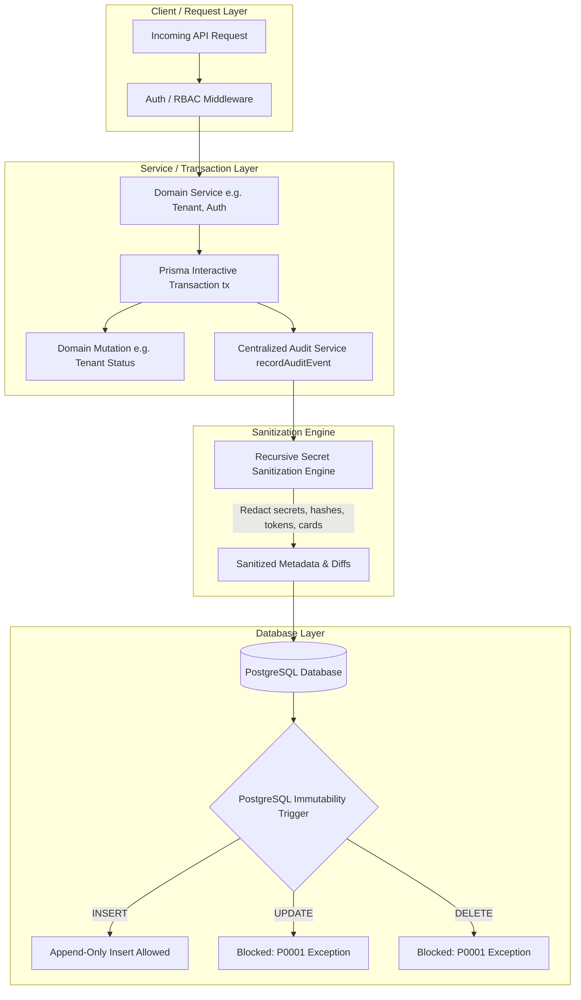

# Architecture Document: 09 — Security & Audit Foundation

- **Module:** 03 — Security & Audit Logs
- **Work Package:** WP-03 — Security & Audit Logging
- **Phase:** 3.1 — Audit Foundation
- **Date:** 2026-11-08
- **Status:** Implemented & Verified

---

## 1. Architectural Philosophy & Immutability Tenets

The BillingBuddy Audit Foundation establishes a centralized, tamper-resistant, append-only record of all security-critical and privileged administrative actions across the multi-tenant platform.



### Core Design Tenets:
1. **Defense-in-Depth Immutability:** Audit records must never be updated or deleted by application logic, ORM operations, compromised credentials, or direct SQL commands. Immutability is enforced at the database engine level via PostgreSQL triggers.
2. **Fail-Closed Transactional Integrity:** When a privileged mutation is executed within a database transaction, audit logging must participate in that exact transaction. If audit creation fails, the mutation must roll back completely—no silent loss of traceability.
3. **Strict Zero-Secret Ingestion:** Secrets (passwords, tokens, OTPs, recovery codes, cookies, authorization headers, private keys, payment card PANs/CVVs) must be stripped recursively *before* database persistence.
4. **Structured Before/After State Diffs:** To ensure high audit forensic value, state mutations record `{ before: {...}, after: {...} }` diffs rather than unstructured strings.
5. **Multi-Tenant Attribution & Platform Visibility:** Every audit record tracks the actor (`actorUserId`, `actorRole`), the target tenant (`targetTenantId`), the subsystem (`module`), the operation type (`eventType`), and request telemetry (`ipAddress`, `userAgent`, `requestId`).

---

## 2. Entity Model & Schema Evolution

The `AuditLog` model in `apps/api/prisma/schema.prisma` is structured to support both platform-wide governance and per-tenant audit query capabilities:

```prisma
model AuditLog {
  id               String   @id @default(uuid())
  actorUserId      String?
  actorRole        String?
  targetTenantId   String?
  module           String?
  eventType        String
  action           String
  status           String   @default("SUCCESS")
  resourceType     String?
  resourceId       String?
  metadata         Json?
  supportSessionId String?
  requestId        String?
  ipAddress        String?
  userAgent        String?
  createdAt        DateTime @default(now())

  actorUser    User?   @relation(fields: [actorUserId], references: [id], onDelete: Restrict)
  targetTenant Tenant? @relation(fields: [targetTenantId], references: [id], onDelete: Restrict)

  @@index([actorUserId])
  @@index([targetTenantId])
  @@index([eventType])
  @@index([createdAt])
  @@index([module])
  @@index([status])
  @@index([requestId])
  @@index([supportSessionId])
}
```

### Field Definitions & Indexing Strategy:
- `id`: UUID primary key.
- `actorUserId`: Nullable foreign key referencing `User(id)` with `onDelete: SetNull`. Retains record history if an actor is decommissioned.
- `actorRole`: Actor's active role during action (`SUPERADMIN`, `STORE_OWNER`, `MANAGER`, `CASHIER`, `SYSTEM`).
- `targetTenantId`: Nullable foreign key referencing `Tenant(id)` with `onDelete: SetNull`. Null for platform-level actions.
- `module`: High-level domain module (`AUTH`, `TENANT_LIFECYCLE`, `PLATFORM_ADMIN`, `RBAC`, `INVENTORY`, `BILLING`, `SYSTEM`). Indexed for faceted filtering.
- `eventType`: Audit classification category (`LIFECYCLE_CHANGE`, `CONFIGURATION_CHANGE`, `SECURITY_EVENT`, `ACCESS_OVERRIDE`, `DATA_MUTATION`, `OPERATIONAL_EVENT`). Indexed for compliance auditing.
- `action`: Hierarchical action verb formatted as `<MODULE>.<ENTITY>.<ACTION>` (e.g. `TENANT.LIFECYCLE.SUSPEND`).
- `status`: Outcome status: `SUCCESS`, `FAILURE`, `ATTEMPTED`, `BLOCKED`. Indexed for operational incident triaging.
- `resourceType` & `resourceId`: Target entity identifier (e.g. `Tenant`, `User`, `OwnerInvitation`).
- `metadata`: JSONB object holding sanitized event metadata, structured diffs (`before`/`after`), and execution context.
- `supportSessionId`: UUID tracking impersonation or support-access sessions (reserved for Module 3.3). Indexed for fast cross-correlation.
- `requestId`: Distributed trace ID / HTTP correlation ID from `req.id` or header `x-request-id`. Indexed for distributed tracing.
- `ipAddress` & `userAgent`: Network context extracted server-authoritatively.
- `createdAt`: UTC timestamp of event creation. Indexed for time-series range queries.

---

## 3. Database Append-Only Immutability Protection

Immutability cannot rely solely on application discipline or API boundaries. PostgreSQL enforces an append-only invariant at the table level.

### 3.1 Hardened Trigger Definition & Zero-Bypass Policy

In migration `20261109120000_audit_integrity_remediation`:

```sql
CREATE OR REPLACE FUNCTION prevent_audit_log_modification()
RETURNS TRIGGER AS $$
BEGIN
    RAISE EXCEPTION 'AuditLog records are append-only and cannot be updated, deleted, or truncated (operation: %)', TG_OP
        USING ERRCODE = 'P0001';
END;
$$ LANGUAGE plpgsql;

-- Row-level trigger for UPDATE or DELETE
DROP TRIGGER IF EXISTS trg_audit_log_immutable ON "AuditLog";
CREATE TRIGGER trg_audit_log_immutable
    BEFORE UPDATE OR DELETE ON "AuditLog"
    FOR EACH ROW
    EXECUTE FUNCTION prevent_audit_log_modification();

-- Statement-level trigger for TRUNCATE
DROP TRIGGER IF EXISTS trg_audit_log_truncate ON "AuditLog";
CREATE TRIGGER trg_audit_log_truncate
    BEFORE TRUNCATE ON "AuditLog"
    FOR EACH STATEMENT
    EXECUTE FUNCTION prevent_audit_log_modification();
```

### 3.2 Immutability Guarantees:
- **Unconditional Rejection:** All `UPDATE`, `DELETE`, and `TRUNCATE` attempts on `AuditLog` are unconditionally blocked by PostgreSQL with error code `P0001`.
- **Zero GUC Bypass:** There are no session variables, request parameters, or environment flags (such as `app.allow_test_audit_cleanup`) that can disable immutability.
- **Foreign Key Referential Integrity:** Foreign keys on `actorUserId` and `targetTenantId` enforce `ON DELETE RESTRICT`. A hard `DELETE` of a User or Tenant who has an audit trail is strictly rejected at the database level.
- **Dedicated Test Database Isolation:** Test suites run against a dedicated test database (`billpos_test`). In `testCleanup.js`, the `validateTestDatabase()` helper checks `SELECT current_database()` and strictly aborts if run on any non-test database (`billpos` or production). Within the dedicated test database only, administrative teardown uses DDL to temporarily disable triggers during teardown.

---

## 4. Shared Audit Taxonomy & Validation Contracts

All audit taxonomy constants and validation schemas reside in `packages/shared/src/contracts/audit.contracts.js`:

### 4.1 Taxonomy Enumerations
```javascript
export const AUDIT_STATUS = {
  SUCCESS: 'SUCCESS',
  FAILURE: 'FAILURE',
  ATTEMPTED: 'ATTEMPTED',
  BLOCKED: 'BLOCKED',
};

export const AUDIT_MODULES = {
  AUTH: 'AUTH',
  TENANT_LIFECYCLE: 'TENANT_LIFECYCLE',
  PLATFORM_ADMIN: 'PLATFORM_ADMIN',
  RBAC: 'RBAC',
  INVENTORY: 'INVENTORY',
  BILLING: 'BILLING',
  SYSTEM: 'SYSTEM',
};

export const AUDIT_EVENT_TYPES = {
  LIFECYCLE_CHANGE: 'LIFECYCLE_CHANGE',
  CONFIGURATION_CHANGE: 'CONFIGURATION_CHANGE',
  SECURITY_EVENT: 'SECURITY_EVENT',
  ACCESS_OVERRIDE: 'ACCESS_OVERRIDE',
  DATA_MUTATION: 'DATA_MUTATION',
  OPERATIONAL_EVENT: 'OPERATIONAL_EVENT',
};
```

### 4.2 Zod Contracts
- `auditDiffSchema`: Validates `{ before: z.record(z.any()).optional(), after: z.record(z.any()).optional() }`.
- `auditMetadataSchema`: Validates arbitrary JSON objects, enforcing optional structured `diff`.
- `recordAuditEventSchema`: Strict runtime contract for all audit invocations:
  - Validates `eventType` against `AUDIT_EVENT_TYPES`.
  - Validates `module` against `AUDIT_MODULES`.
  - Enforces mandatory `action` string.
  - Validates `status` against `AUDIT_STATUS` (default: `SUCCESS`).
  - Supports optional actor, tenant, resource, network, and metadata fields.

---

## 5. Centralized Backend Audit Service

Located in `apps/api/src/services/audit.service.js`, `recordAuditEvent` is the single authoritative entry point for recording audit logs.

### 5.1 Service Signature
```javascript
export async function recordAuditEvent(payload, options = {}) {
  // payload: validated via recordAuditEventSchema
  // options.tx: optional Prisma interactive transaction client
  // options.req: optional Express request object for automatic context extraction
}
```

### 5.2 Context Extraction & Transaction Awareness
- **Express Context Extraction:** If `options.req` is provided, `recordAuditEvent` automatically infers:
  - `ipAddress`: derived from `req.ip` or `req.socket.remoteAddress`.
  - `userAgent`: extracted from `req.headers['user-agent']`.
  - `requestId`: extracted from `req.id`, `req.headers['x-request-id']`, or `req.headers['x-correlation-id']`.
  - `actorUserId` & `actorRole`: resolved from `req.user` or session state if not explicitly passed.
- **Transactional Atomicity:** Accepts `options.tx` (Prisma transaction client).
  ```javascript
  await prisma.$transaction(async (tx) => {
    // 1. Perform business mutation
    const updatedTenant = await tx.tenant.update({ ... });

    // 2. Record audit within the exact same transaction
    await recordAuditEvent({
      targetTenantId: tenantId,
      module: AUDIT_MODULES.TENANT_LIFECYCLE,
      eventType: AUDIT_EVENT_TYPES.LIFECYCLE_CHANGE,
      action: 'TENANT.LIFECYCLE.SUSPEND',
      metadata: { diff: { before: { status: 'ACTIVE' }, after: { status: 'SUSPENDED' } } }
    }, { tx, req });
  });
  ```
  If `recordAuditEvent` fails (e.g. constraint violation or DB error), the error bubbles up, aborting and rolling back the business mutation.

---

## 6. Recursive Secret Sanitization Engine

Before any metadata is passed to the database, `sanitizeAuditMetadata()` deep-cleans all objects, arrays, and nested structures.

### 6.1 Redaction Key Patterns
Keys matching any of the following normalized patterns are replaced with `"[REDACTED]"`:
- `password`, `passwordhash`, `currentpassword`, `newpassword`
- `token`, `sessiontoken`, `refreshtoken`, `accesstoken`, `rawtoken`, `tokenhash`
- `secret`, `totpsecret`, `clientsecret`, `sharedsecret`
- `recoverycode`, `recoverycodes`, `recoverycodehash`, `backupcodes`
- `otp`, `passcode`, `pin`
- `authorization`, `authheader`, `cookie`, `setcookie`
- `creditcard`, `cardnumber`, `cvv`, `cvc`, `pan`
- `apikey`, `privatekey`, `secretkey`
- `credentials`, `bearer`, `jwt`, `auth`, `authorizationheader`

### 6.2 Safe Non-Sensitive Keys
Keys representing entity IDs (e.g. `userId`, `tenantId`, `invitationId`, `membershipId`) or status codes are explicitly preserved.

### 6.3 Circular Reference & Array Safety
The sanitization engine maintains a `WeakSet` tracking traversed object references. Circular references are safely replaced with `"[CIRCULAR]"`, preventing stack overflow vulnerabilities during JSON serialization.

---

## 7. Downstream Module Integration Guide

Future modules must follow this integration checklist when introducing new privileged operations:

| Module | Operation | Module Constant | Event Type | Action Pattern |
|---|---|---|---|---|
| **Auth 3.2** | Superadmin Credentials Login | `AUTH` | `SECURITY_EVENT` | `AUTH.SUPERADMIN.LOGIN_SUCCESS` |
| **Auth 3.2** | Superadmin TOTP Verification | `AUTH` | `SECURITY_EVENT` | `AUTH.SUPERADMIN.TOTP_SUCCESS` |
| **Auth 3.2** | Account Lockout Triggered | `AUTH` | `SECURITY_EVENT` | `AUTH.ACCOUNT.LOCKOUT` |
| **Auth 3.2** | Store Owner Logout | `AUTH` | `SECURITY_EVENT` | `AUTH.OWNER.LOGOUT` |
| **Support 3.3** | Superadmin Impersonation Session | `PLATFORM_ADMIN` | `ACCESS_OVERRIDE` | `SUPPORT.SESSION.INITIATE` |
| **Support 3.3** | Impersonation Session Terminated | `PLATFORM_ADMIN` | `ACCESS_OVERRIDE` | `SUPPORT.SESSION.TERMINATE` |
| **Inventory** | Stock Level Adjustment | `INVENTORY` | `DATA_MUTATION` | `INVENTORY.STOCK.ADJUST` |
| **Billing** | Invoice Void / Refund | `BILLING` | `DATA_MUTATION` | `BILLING.INVOICE.REFUND` |

---

## 8. Verification & Test Evidence Baseline

The Audit Foundation was verified across unit, integration, and transactional boundaries:

1. **`audit-contracts.test.js` (10 tests):** Enforces contract schema validation, diff constraints, status enums, and module definitions.
2. **`audit-service.test.js` (11 tests):** Verifies secret sanitization, extended credentials/bearer/jwt/auth redaction, nested object redaction, circular reference safety, transaction awareness, and atomicity rollbacks.
3. **`audit-immutability.test.js` (10 tests):** Validates database-level append-only protection: normal `INSERT` succeeds, SQL `UPDATE` fails unconditionally with `P0001`, SQL `DELETE` fails unconditionally with `P0001`, `TRUNCATE` is rejected with `P0001`, setting `app.allow_test_audit_cleanup` cannot bypass protection, `validateTestDatabase` rejects non-test DBs, `User` and `Tenant` hard deletions are rejected via `ON DELETE RESTRICT`, and test cleanup succeeds only within the dedicated test database.
4. **Regression Suites:** All existing platform tenant lifecycle and owner auth tests pass (total 224 API tests, 102 Web tests, 62 Shared tests passing, totaling 388/388 tests across the workspace).
