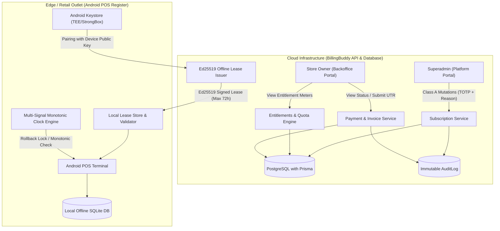

# BillingBuddy — WP-SUB-02: Architecture Blueprint
## Subscription & Entitlements Functional Module

- **Document Identifier:** `WP-SUB-02-ARCH`
- **Module ID:** `SUB-ENTITLEMENTS-01`
- **Version:** `1.2.0` (Updated: Resolves Clarifications A, B, and C)
- **Status:** `READY_FOR_FINAL_OWNER_REVIEW`
- **Target Repository:** `BillingBuddy` (`E:\Projects\BillPOS`)
- **Execution Mode:** Documentation and Architecture Design Only

---

## 1. System Context & Architectural Mission

The **Subscription & Entitlements** module governs tenant commercial onboarding, plan tiers, usage quota metering, operational grace periods, read-only modes, Android Keystore device identity, offline cryptographic leasing, and manual payment auditing.

---

## 2. Core Architectural Invariants

1. **Separation of the Three State Domains (Clarification C):**
   - Platform compliance is controlled by `Tenant.status` (`ACTIVE`, `INACTIVE`, `SUSPENDED`).
   - Commercial authorization is controlled by `TenantSubscription.status` (`TRIAL`, `ACTIVE`, `GRACE_PERIOD`, `READ_ONLY`, `SUSPENDED`, `CANCELED`, `EXPIRED`).
   - Financial transaction progress is controlled by `SubscriptionPayment.status` (`PENDING`, `VERIFIED`, `REJECTED`).
   - **Crucial Rule:** Submitting a payment reference (UTR) **never** automatically activates a subscription. Only verified payment or authorized Superadmin mutation can activate or renew subscriptions.
2. **Subscription History via Partial Unique Index:**
   - A tenant maintains a complete history of all past and current subscription records.
   - Decision D-02 (one active plan per tenant) is enforced strictly via a PostgreSQL partial unique index:
     `CREATE UNIQUE INDEX "idx_tenant_subscriptions_single_active" ON "TenantSubscription" ("tenantId") WHERE "status" IN ('TRIAL', 'ACTIVE', 'GRACE_PERIOD', 'READ_ONLY', 'SUSPENDED');`
3. **Four-Tier Financial Architecture & Decimal Integer Strings (Clarification B):**
   - **Tier 1 (Database):** PostgreSQL `BIGINT` / Prisma `BigInt` (`99900n`).
   - **Tier 2 (Calculation):** JavaScript native `BigInt` paise arithmetic. Zero floats.
   - **Tier 3 (API Wire):** Canonical **decimal integer strings** (`"amountPaise": "99900"`).
   - **Tier 4 (Presentation):** Formatted currency string (`"amountFormatted": "₹999.00"`).
4. **Android Keystore-Backed Device Identity (Clarification A):**
   - POS devices generate an asymmetric key pair inside the hardware-backed Android Keystore (TEE/StrongBox).
   - Leases are cryptographically locked to the device's registered public key.
5. **Zero Offline Self-Extension (Clarification A & Decision D-07):**
   - The 72-hour offline lease lifetime is anchored strictly to the server's `issuedAt` timestamp. An offline terminal can never self-extend. Setting the clock backward $>60\text{s}$ triggers `TAMPER_LOCKED` state.
6. **Pessimistic Row-Locking Quota Invariant (Decision D-06):**
   - All quota mutations acquire an exclusive row lock (`SELECT ... FOR UPDATE`) on the active `TenantSubscription` row before asserting quota availability.
7. **Read-Only Access Policy (Decision D-04):**
   - Expiration past 72-hour grace halts POS checkout and entity mutations while guaranteeing access to view reports, download past receipts, export tax data, and submit renewal payments.
8. **UX Separation:**
   - Retail walk-in counter checkout remains strictly at `/owner/billing` (`OwnerBillingPage.jsx`). Subscription management resides at `/owner/subscription`.
