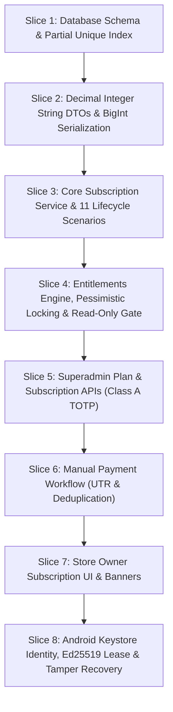

# BillingBuddy — WP-SUB-02: Implementation Roadmap & Work Breakdown
## 8-Slice Vertical Implementation Architecture

- **Document Identifier:** `WP-SUB-02-ROADMAP`
- **Module ID:** `SUB-ENTITLEMENTS-01`
- **Version:** `1.2.0` (Updated: Resolves Clarifications A, B, and C)
- **Status:** `READY_FOR_FINAL_OWNER_REVIEW`
- **Target Repository:** `BillingBuddy` (`E:\Projects\BillPOS`)
- **Execution Mode:** Documentation and Architecture Design Only

---

## 1. Executive Summary & Delivery Strategy

This implementation roadmap decomposes the **Subscription & Entitlements** module into eight sequential, independently testable vertical slices. Each slice integrates all technical clarifications and security invariants.



---

## 2. Vertical Slices Breakdown

### Slice 1: Database Schema & Migration Foundation

- **Objective:** Provision relational models, enums, foreign keys, indexes, and the PostgreSQL partial unique index.
- **Scope & Deliverables:**
  - Update `prisma/schema.prisma` with models: `Plan`, `PlanPrice`, `PlanFeature`, `TenantSubscription`, `TenantEntitlementOverride`, `SubscriptionInvoice`, `SubscriptionPayment`, `UsageRecord`.
  - Add `devicePublicKeyPem` and `devicePublicKeyThumbprint` to `PosDevice`.
  - Migration script: `prisma/migrations/20261110000000_subscription_entitlements/migration.sql` including:
    ```sql
    CREATE UNIQUE INDEX "idx_tenant_subscriptions_single_active" 
    ON "TenantSubscription" ("tenantId") 
    WHERE "status" IN ('TRIAL', 'ACTIVE', 'GRACE_PERIOD', 'READ_ONLY', 'SUSPENDED');
    ```
  - Seed script: `prisma/seeds/subscriptionPlans.seed.js` to seed `TRIAL_14`, `STARTER`, `GROWTH`, and `ENTERPRISE` tiers.
- **Verification Gate:**
  - Migration executes cleanly; partial unique index enforces exactly one active subscription per tenant while allowing multiple expired/canceled historical records.

---

### Slice 2: Shared Contracts, Decimal Integer String DTOs & Currency Math (Clarification B)

- **Objective:** Canonical runtime contracts, decimal integer string validation, and BigInt serialization.
- **Scope & Deliverables:**
  - `packages/shared/src/contracts/subscription.contracts.js`
  - Explicit DTO mappers (`packages/shared/src/dto/subscription.dto.js`) serializing BigInt fields to `{ "amountPaise": "99900", "amountFormatted": "₹999.00" }` without prototype modification.
  - Zod schemas validating decimal integer strings (`z.string().regex(/^\d+$/)`).
  - Extension of `AUDIT_MODULES.BILLING` in `packages/shared/src/contracts/audit.contracts.js`.
- **Verification Gate:**
  - Zero floating-point conversions; JSON serialization tests verify no `BigInt` serialization exceptions.

---

### Slice 3: Core Subscription Service & 11 Lifecycle Scenarios (Clarification C)

- **Objective:** Business logic for full subscription lifecycle transitions, trial provisioning, and cron evaluation.
- **Scope & Deliverables:**
  - `apps/api/src/services/subscription.service.js`
  - Automatic 14-day trial provisioning on tenant activation (`D-03`).
  - Full state transition engine covering all 11 lifecycle coordination scenarios.
  - Handling of scheduled cancellations (`cancelAtPeriodEnd = true`) vs immediate cancellations.
  - Complete decoupling from `Tenant.status`.
  - Cron runner evaluating period expirations.
- **Verification Gate:**
  - Unit tests covering all 11 lifecycle scenarios and asserting rejection on invalid transitions.

---

### Slice 4: Entitlements Engine, Pessimistic Locking & Read-Only Gate

- **Objective:** Concurrency-safe resource metering, row-level pessimistic locking, and read-only routing enforcement.
- **Scope & Deliverables:**
  - `apps/api/src/services/entitlements.service.js`
  - Pessimistic row locking on active `TenantSubscription` using `SELECT ... FOR UPDATE` before asserting quota (`D-06`).
  - Downgrade validation algorithm blocking transitions when usage exceeds target limits (`D-05`).
  - `apps/api/src/middlewares/subscriptionEnforcement.middleware.js` implementing the exhaustive read-only allowlist (permitting GETs, UTR submissions, data export, shift closing; blocking POS checkout and entity mutations).
- **Verification Gate:**
  - Concurrency tests passing (5 concurrent outlet creations on 1-slot limit results in exactly 1 success).
  - Read-only allowlist tests passing.

---

### Slice 5: Superadmin Plan Catalog & Subscription APIs (D-08)

- **Objective:** Platform APIs for plan management, period extension, manual plan assignment, and overrides.
- **Scope & Deliverables:**
  - `apps/api/src/controllers/platform/subscription.controller.js`
  - Integration with `assertPrivilegedMutationAuthorized` for Class A step-up TOTP verification.
  - Structured immutable audit logging for all mutations.
- **Verification Gate:**
  - 2FA gating validated; unauthorized requests without TOTP return 401; audit records logged with structured before/after diffs.

---

### Slice 6: Manual Payment Workflow & Reconciliation (D-09)

- **Objective:** Manual UPI / Bank Transfer payment submission, deduplication, and Superadmin reconciliation.
- **Scope & Deliverables:**
  - `apps/api/src/services/subscriptionPayment.service.js`
  - UTR submission endpoint (`POST /owner/subscription/payments/submit-utr`).
  - Global unique UTR index enforcing duplicate rejection.
  - Superadmin verification endpoint (`POST /platform/payments/:id/verify`) with TOTP step-up.
  - Automated invoice settlement and period renewal upon verification.
- **Verification Gate:**
  - Duplicate UTR submission returns `409 Conflict`. Superadmin approval extends period and transitions subscription to `ACTIVE`.

---

### Slice 7: Store Owner Subscription UI & Grace Banners

- **Objective:** Dedicated Store Owner management interface, quota meters, and grace/read-only banners.
- **Scope & Deliverables:**
  - `apps/web/src/pages/owner/subscription/OwnerSubscriptionPage.jsx`
  - Quota usage progress bars, bank details & UPI QR display, UTR submission modal.
  - Amber grace period warning banner and red read-only lockout modal.
  - **Zero impact or modification to `/owner/billing` retail POS counter.**
- **Verification Gate:**
  - Owner subscription UI operational; POS register at `/owner/billing` remains isolated and untouched.

---

### Slice 8: Android Keystore Identity, Ed25519 Lease & Tamper Recovery (Clarification A & Decision D-07)

- **Objective:** Android Keystore device pairing, Ed25519-signed offline leases, multi-signal anti-tampering, and recovery workflow.
- **Scope & Deliverables:**
  - `apps/api/src/services/offlineLease.service.js` (Ed25519 signing using server private key).
  - `apps/api/src/controllers/pos/devicePairing.controller.js` (Handling `POST /api/v1/pos/devices/pair`).
  - `apps/api/src/controllers/pos/leaseRecovery.controller.js` (Handling `POST /api/v1/pos/lease/recover`).
  - `apps/pos/src/services/androidKeystore.js` (Keypair generation and thumbprint extraction).
  - `apps/pos/src/services/antiTamperClock.js` (Monotonic clock and reboot detection).
  - Hard wall-clock expiration check (`clock > exp`).
- **Verification Gate:**
  - Cryptographic verification test passing; clock rollback test confirms immediate lockout of checkout; recovery endpoint successfully syncs queued offline transactions.
